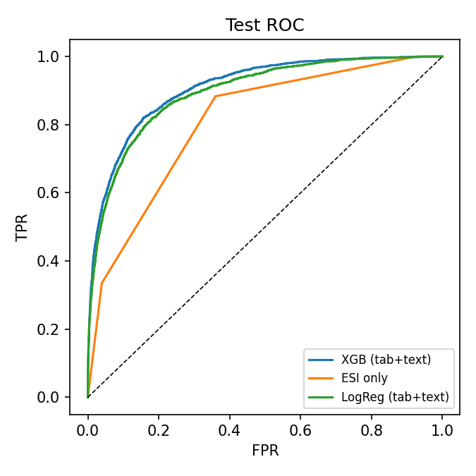
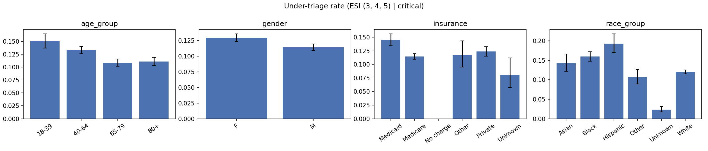
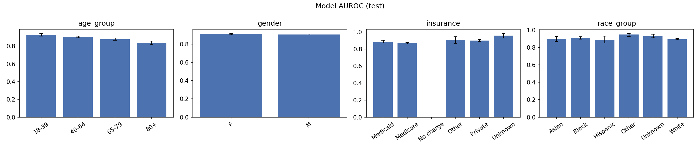
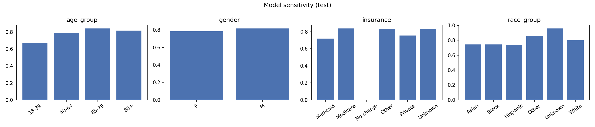
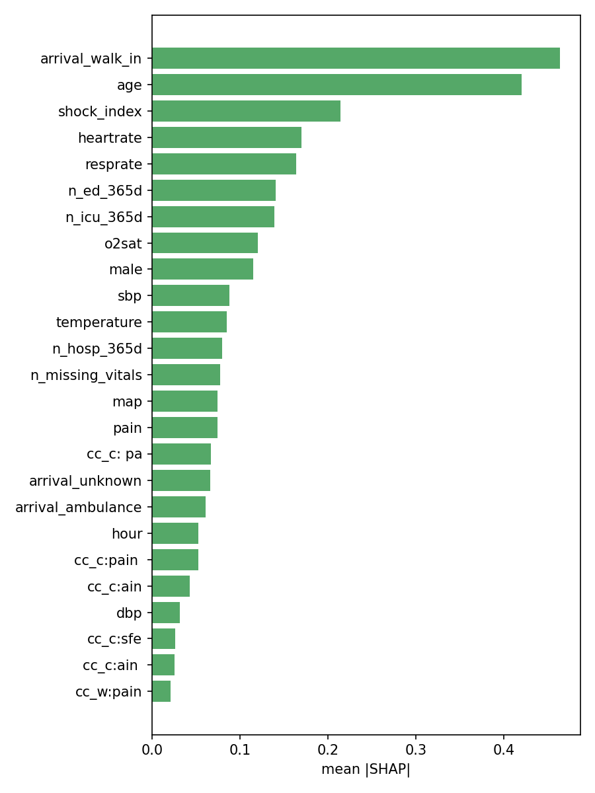

# Results — ED Under-triage Detector + Fairness Audit

*MIMIC-IV-ED, full cohort. Aggregate results only; cells with fewer than 10 patients are suppressed.*

## Cohort
| | |
|---|---|
| ED stays (adults, triage acuity recorded) | 418,025 |
| Patients | 201,214 |
| Outcome (`critical`) rate | 5.985% |
| Split by patient (train / val / test) | 335,014 / 41,383 / 41,628 |
| ESI distribution | ESI 1: 24,014, ESI 2: 139,390, ESI 3: 225,024, ESI 4: 28,497, ESI 5: 1,100 |

## Prediction of the critical outcome (test set)
Threshold chosen on validation for sensitivity ≈ 80%. The model does not see the nurse's ESI.

| Model | AUROC (95% CI) | AUPRC | Sensitivity | Specificity | PPV | Flag rate |
|---|---|---|---|---|---|---|
| XGBoost (tabular + chief complaint) | 0.909 (0.903–0.914) | 0.524 | 0.803 | 0.855 | 0.263 | 0.184 |
| Logistic regression (tabular + text) | 0.895 | 0.494 | 0.809 | 0.827 | 0.231 | 0.211 |
| ESI only (flag ESI 1–2) | 0.809 (0.802–0.817) | 0.200 | 0.883 | 0.640 | 0.136 | 0.392 |
| ESI only (flag ESI 1–3) | 0.809 | 0.200 | 1.000 | 0.075 | 0.065 | 0.929 |

### Catching under-triage: performance inside the low-acuity group
| Low-acuity group | n | n with outcome | AUROC | Under-triaged caught (sens.) | Flag rate |
|---|---|---|---|---|---|
| ESI (3, 4, 5) | 25326 | 293 | 0.831 | 0.406 | 0.067 |
| ESI (4, 5) | 2937 | <10 | – | – | 0.006 |

## Fairness audit: who gets under-triaged?
Under-triage rate = share of patients **with** the critical outcome who were triaged ESI (3, 4, 5).
A strict ESI (4, 5) definition is in `tables/undertriage_by_group_esi_strict.csv` (most cells suppressed: too few events).

| attribute | group | n_stays | n_outcome | n_under_triaged | Under-triage rate (95% CI) |
|---|---|---|---|---|---|
| age_group | 18-39 | 129068 | 2531 | 380 | 0.150 (0.137–0.165) |
| age_group | 40-64 | 158072 | 8482 | 1127 | 0.133 (0.126–0.140) |
| age_group | 65-79 | 81154 | 7751 | 840 | 0.108 (0.102–0.115) |
| age_group | 80+ | 49731 | 6255 | 692 | 0.111 (0.103–0.119) |
| gender | F | 226962 | 11610 | 1507 | 0.130 (0.124–0.136) |
| gender | M | 191063 | 13409 | 1532 | 0.114 (0.109–0.120) |
| insurance | Medicaid | 79343 | 4244 | 618 | 0.146 (0.135–0.157) |
| insurance | Medicare | 131996 | 14233 | 1632 | 0.115 (0.110–0.120) |
| insurance | No charge | 113 | <10 | <10 | – |
| insurance | Other | 8539 | 682 | 80 | 0.117 (0.095–0.144) |
| insurance | Private | 93057 | 5475 | 678 | 0.124 (0.115–0.133) |
| insurance | Unknown | 104977 | 384 | 31 | 0.081 (0.057–0.112) |
| race_group | Asian | 18321 | 925 | 132 | 0.143 (0.122–0.167) |
| race_group | Black | 92148 | 3589 | 573 | 0.160 (0.148–0.172) |
| race_group | Hispanic | 35195 | 1025 | 198 | 0.193 (0.170–0.218) |
| race_group | Other | 23554 | 1066 | 114 | 0.107 (0.090–0.127) |
| race_group | Unknown | 6174 | 1999 | 47 | 0.024 (0.018–0.031) |
| race_group | White | 242633 | 16415 | 1975 | 0.120 (0.115–0.125) |

### Statistical tests (χ², among patients with the outcome)
| attribute | chi2 | dof | p_value |
|---|---|---|---|
| age_group | 49.166 | 3 | 0.000 |
| gender | 13.955 | 1 | 0.000 |
| insurance | 35.879 | 5 | 0.000 |
| race_group | 284.392 | 5 | 0.000 |

### Adjusted odds of being triaged low-acuity
Adjusted for triage vitals, pain and ambulance arrival, among patients with the outcome. OR > 1 means more likely to be under-triaged than the reference group.

| term | odds_ratio | or_lo | or_hi | p_value |
|---|---|---|---|---|
| age_group: 18-39 vs 40-64 | 1.160 | 1.015 | 1.326 | 0.029 |
| age_group: 65-79 vs 40-64 | 0.887 | 0.792 | 0.994 | 0.040 |
| age_group: 80+ vs 40-64 | 0.978 | 0.861 | 1.112 | 0.737 |
| gender: F vs M | 1.128 | 1.042 | 1.221 | 0.003 |
| insurance: Medicaid vs Medicare | 1.030 | 0.909 | 1.167 | 0.640 |
| insurance: Other vs Medicare | 0.784 | 0.606 | 1.014 | 0.064 |
| insurance: Other/small vs Medicare | 0.000 | 0.000 | 164123560846208515611533905571033015954776035182336995329494362110317808020250419724812288.000 | 0.939 |
| insurance: Private vs Medicare | 0.893 | 0.793 | 1.005 | 0.061 |
| insurance: Unknown vs Medicare | 0.854 | 0.577 | 1.265 | 0.431 |
| race_group: Asian vs White | 1.143 | 0.938 | 1.392 | 0.185 |
| race_group: Black vs White | 1.261 | 1.134 | 1.403 | 0.000 |
| race_group: Hispanic vs White | 1.456 | 1.226 | 1.728 | 0.000 |
| race_group: Other vs White | 0.800 | 0.651 | 0.982 | 0.033 |
| race_group: Unknown vs White | 0.171 | 0.127 | 0.230 | 0.000 |

## Model fairness by group (test set)
| attribute | group | n | auroc | tpr | fpr | ppv | ece | under_triage_caught |
|---|---|---|---|---|---|---|---|---|
| age_group | 18-39 | 12777 | 0.930 | 0.675 | 0.034 | 0.280 | 0.004 | 0.250 |
| age_group | 40-64 | 15463 | 0.904 | 0.790 | 0.129 | 0.258 | 0.003 | 0.429 |
| age_group | 65-79 | 8335 | 0.879 | 0.844 | 0.249 | 0.265 | 0.005 | 0.450 |
| age_group | 80+ | 5053 | 0.839 | 0.817 | 0.334 | 0.260 | 0.014 | 0.405 |
| gender | F | 22795 | 0.910 | 0.785 | 0.127 | 0.253 | 0.002 | 0.381 |
| gender | M | 18833 | 0.906 | 0.818 | 0.167 | 0.271 | 0.003 | 0.435 |
| insurance | Medicaid | 7464 | 0.887 | 0.721 | 0.123 | 0.241 | 0.003 | 0.338 |
| insurance | Medicare | 13165 | 0.869 | 0.840 | 0.275 | 0.275 | 0.006 | 0.433 |
| insurance | No charge | 16 | – | – | 0.000 | – | – | – |
| insurance | Other | 821 | 0.910 | 0.831 | 0.118 | 0.378 | 0.022 | – |
| insurance | Private | 9516 | 0.899 | 0.756 | 0.119 | 0.286 | 0.008 | 0.433 |
| insurance | Unknown | 10646 | 0.958 | 0.830 | 0.040 | 0.084 | 0.013 | – |
| race_group | Asian | 1854 | 0.897 | 0.743 | 0.099 | 0.311 | 0.017 | 0.400 |
| race_group | Black | 8763 | 0.910 | 0.744 | 0.105 | 0.210 | 0.004 | 0.342 |
| race_group | Hispanic | 3589 | 0.890 | 0.742 | 0.084 | 0.234 | 0.005 | 0.259 |
| race_group | Other | 2234 | 0.948 | 0.860 | 0.114 | 0.246 | 0.006 | 0.500 |
| race_group | Unknown | 598 | 0.931 | 0.960 | 0.315 | 0.607 | 0.038 | – |
| race_group | White | 24590 | 0.895 | 0.800 | 0.172 | 0.254 | 0.004 | 0.429 |

### Largest gaps
| attribute | metric | max_group | max | min_group | min | difference | ratio |
|---|---|---|---|---|---|---|---|
| age_group | under_triage_rate | 18-39 | 0.150 | 65-79 | 0.108 | 0.042 | 1.385 |
| age_group | outcome_rate_in_low_acuity | 80+ | 0.032 | 18-39 | 0.004 | 0.028 | 7.803 |
| gender | under_triage_rate | F | 0.130 | M | 0.114 | 0.016 | 1.136 |
| gender | outcome_rate_in_low_acuity | M | 0.014 | F | 0.010 | 0.003 | 1.331 |
| insurance | under_triage_rate | Medicaid | 0.146 | Unknown | 0.081 | 0.065 | 1.804 |
| insurance | outcome_rate_in_low_acuity | Medicare | 0.026 | Unknown | 0.000 | 0.025 | 69.869 |
| race_group | under_triage_rate | Hispanic | 0.193 | Unknown | 0.024 | 0.170 | 8.216 |
| race_group | outcome_rate_in_low_acuity | Unknown | 0.019 | Other | 0.007 | 0.012 | 2.579 |
| age_group | auroc | 18-39 | 0.930 | 80+ | 0.839 | 0.091 | 1.108 |
| age_group | tpr | 65-79 | 0.844 | 18-39 | 0.675 | 0.169 | 1.251 |
| age_group | fpr | 80+ | 0.334 | 18-39 | 0.034 | 0.300 | 9.699 |
| age_group | under_triage_caught | 65-79 | 0.450 | 18-39 | 0.250 | 0.200 | 1.800 |
| age_group | ece | 80+ | 0.014 | 40-64 | 0.003 | 0.011 | 4.552 |
| gender | auroc | F | 0.910 | M | 0.906 | 0.004 | 1.005 |
| gender | tpr | M | 0.818 | F | 0.785 | 0.033 | 1.042 |
| gender | fpr | M | 0.167 | F | 0.127 | 0.040 | 1.315 |
| gender | under_triage_caught | M | 0.435 | F | 0.381 | 0.054 | 1.142 |
| gender | ece | M | 0.003 | F | 0.002 | 0.002 | 2.135 |
| insurance | auroc | Unknown | 0.958 | Medicare | 0.869 | 0.089 | 1.102 |
| insurance | tpr | Medicare | 0.840 | Medicaid | 0.721 | 0.119 | 1.165 |
| insurance | fpr | Medicare | 0.275 | No charge | 0.000 | 0.275 | – |
| insurance | under_triage_caught | Private | 0.433 | Medicaid | 0.338 | 0.095 | 1.280 |
| insurance | ece | Other | 0.022 | Medicaid | 0.003 | 0.018 | 6.599 |
| race_group | auroc | Other | 0.948 | Hispanic | 0.890 | 0.057 | 1.064 |
| race_group | tpr | Unknown | 0.960 | Hispanic | 0.742 | 0.219 | 1.295 |
| race_group | fpr | Unknown | 0.315 | Hispanic | 0.084 | 0.231 | 3.753 |
| race_group | under_triage_caught | Other | 0.500 | Hispanic | 0.259 | 0.241 | 1.929 |
| race_group | ece | Unknown | 0.038 | Black | 0.004 | 0.034 | 10.011 |

## What drives the model (mean |SHAP|, test set)
| feature | mean_abs_shap |
|---|---|
| arrival_walk_in | 0.464 |
| age | 0.421 |
| shock_index | 0.214 |
| heartrate | 0.170 |
| resprate | 0.164 |
| n_ed_365d | 0.141 |
| n_icu_365d | 0.139 |
| o2sat | 0.121 |
| male | 0.115 |
| sbp | 0.088 |
| temperature | 0.085 |
| n_hosp_365d | 0.080 |
| n_missing_vitals | 0.077 |
| map | 0.075 |
| pain | 0.075 |

---
Runtime of the last session: 0.99 min.
